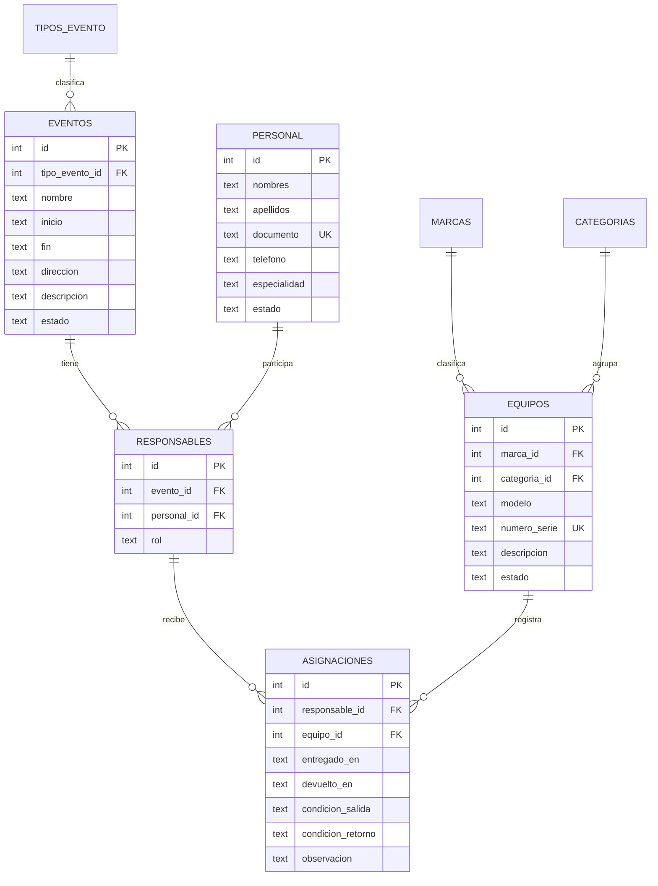

# Modelo de datos de LENS

El prototipo conserva la cadena central de tu diagrama: **evento → responsable → equipo asignado**. La relación responsable representa a una persona trabajando en un evento y permite que esa persona tenga varios equipos a su cargo. Los cambios de esta demostración no modifican tus archivos originales.

## Diagrama implementado

`RESPONSABLES` tiene una restricción única sobre `(evento_id, personal_id)`. `ASIGNACIONES` protege `(responsable_id, equipo_id)` y la capa de servicio impide repetir un equipo entre responsables del mismo evento. Los cruces horarios también se validan en el servicio dentro de la transacción; no están implementados como triggers SQL. Las escrituras deben pasar por la API.

## Ajustes aplicados en la demostración

| Referencia original | Prototipo | Motivo |
| --- | --- | --- |
| `fechahoraevento` | `inicio` y `fin` | Calcular cruces y soportar eventos de varios días. |
| `USUARIOS` con datos personales y credenciales | `PERSONAL`, sin credenciales | Registrar trabajadores sin simular un sistema de acceso que todavía no existe. |
| `EQUIPAMIENTO` | `ASIGNACIONES` | Expresar que cada fila es una reserva/entrega de un activo a un responsable. |
| Un único `estado` del equipo | Estado operativo y disponibilidad calculada | Una reserva futura no convierte al activo en averiado o físicamente entregado. |
| Serie sin restricción explícita | Serie/código obligatorio y único | Identificar cada unidad; los accesorios sin serie usan un código interno. |
| Entrega/devolución | Fechas reales inicialmente nulas | Diferenciar reservar de entregar; conservar condición e historial. |
| Borrado sin política explícita | Claves foráneas con `RESTRICT` | Evitar pérdida accidental de relaciones e historial. |

En el ejemplo todos los eventos tienen un lugar escrito. `esLocal` y `referencia` se simplifican en `direccion` y `descripcion`; pueden volver como campos independientes si necesitas filtrar estudio frente a cobertura externa. `horacitacion` y `estadoasistencia` quedan pendientes: la reserva de personal usa el intervalo completo del evento.

## Decisiones para conversar antes de ampliar

1. **Clientes y alcance.** Tu documento excluye la gestión de clientes, pero el diagrama contiene `CLIENTES`. En esta demo no se incluye ese módulo. Puedes mantener solo un contacto de coordinación en el evento o conservar una tabla de clientes de referencia, si esa información es necesaria para operar.
2. **Incidencias separadas.** Conviene una tabla `INCIDENCIAS` ligada a la asignación, con descripción, fecha, gravedad, estado y persona que reporta. Permitiría varias incidencias por entrega y seguimiento hasta su cierre. Una observación de retorno no cubre ese flujo completo.
3. **Personal y acceso.** Cuando haya login, crea `USUARIOS` separado de `PERSONAL`, con relación opcional entre ambos. Almacena un hash seguro de contraseña, nunca el texto de `passuser`. Distingue el rol del trabajador en un evento de sus permisos dentro del sistema.
4. **Tiempo de traslado y preparación.** Añade márgenes o un intervalo de reserva propio: el recurso puede necesitar estar ocupado antes de que empiece el evento y después de que termine. La hora de citación puede ser anterior al inicio de la cobertura.
5. **Accesorios y kits.** Decide qué debe tener identificación individual y qué puede controlarse por cantidad. Para kits, utiliza una tabla de componentes; una descripción libre no permite comprobar si se devolvió cada batería o tarjeta.
6. **Cambios y trazabilidad.** Agrega auditoría (`creado_por`, `actualizado_por`, fecha y valores anteriores) y archivado de entidades. Para reasignar un equipo después de entregarlo, registra un movimiento nuevo en lugar de sobrescribir el responsable anterior.

## Indicadores

En la documentación, el KPI de solapamientos mezcla intentos rechazados y conflictos no controlados. Para medirlo con claridad, separa **intentos de reserva rechazados / total de intentos** de **reservas incompatibles realmente guardadas**, cuyo objetivo es cero. La demo evita los cruces pero no registra cada intento fallido para calcular ese indicador.

Los tiempos de despacho requieren marcas de inicio y fin de la inspección; las fechas de entrega y devolución por sí solas miden permanencia del equipo fuera del almacén. Para utilización del inventario, define el período y qué horas constituyen capacidad disponible antes de calcular el porcentaje.
